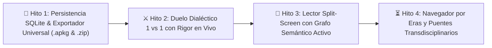
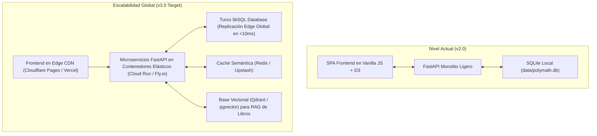
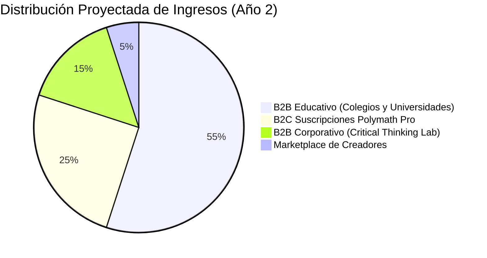
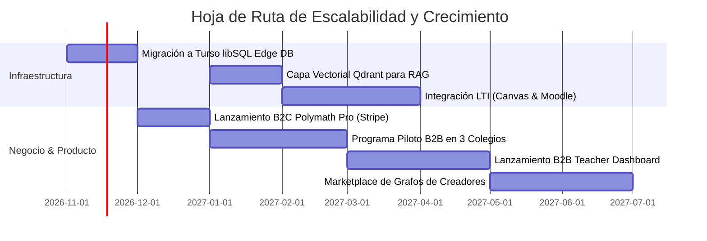

# 🚀 Plan Estratégico de Escalabilidad Técnica y Monetización · Polymath Graph (v2.0)

Este documento condensa los avances alcanzados en la plataforma, las metodologías para validar cada innovación y la hoja de ruta integral para escalar el sistema a millones de usuarios manteniendo una estructura de costes ultracontrolada y múltiples vías de monetización de alto margen.

---

## 📑 Índice
1. [Resumen Ejecutivo: Lo que hemos construido](#1-resumen-ejecutivo-lo-que-hemos-construido)
2. [Guía Rápida de Verificación y Pruebas](#2-guía-rápida-de-verificación-y-pruebas)
3. [Caminos de Escalabilidad Técnica](#3-caminos-de-escalabilidad-técnica)
   - [Camino A: De SQLite Local a Edge Database con Turso (libSQL)](#camino-a-de-sqlite-local-a-edge-database-con-turso-libsql)
   - [Camino B: Arquitectura Serverless y Despliegue Global](#camino-b-arquitectura-serverless-y-despliegue-global)
   - [Camino C: Capa Vectorial de Alta Dimensión para RAG de Libros Completos](#camino-c-capa-vectorial-de-alta-dimensión-para-rag-de-libros-completos)
   - [Camino D: Multi-inquilino (Multi-tenant) Institucional](#camino-d-multi-inquilino-multi-tenant-institucional)
4. [Modelo Integral de Monetización](#4-modelo-integral-de-monetización)
   - [1. Modelo B2C Freemium (Estudiantes y Autodidactas)](#1-modelo-b2c-freemium-estudiantes-y-autodidactas)
   - [2. Modelo B2B Educativo (Colegios, Universidades y Bootcamps)](#2-modelo-b2b-educativo-colegios-universidades-y-bootcamps)
   - [3. Modelo B2B Corporativo (Decision & Critical Thinking Lab)](#3-modelo-b2b-corporativo-decision--critical-thinking-lab)
   - [4. Marketplace de Grafos y Creadores de Contenido](#4-marketplace-de-grafos-y-creadores-de-contenido)
5. [Hoja de Ruta Trimestral de Ejecución](#5-hoja-de-ruta-trimestral-de-ejecución)

---

## 1. Resumen Ejecutivo: Lo que hemos construido

A lo largo de las sesiones de ingeniería, transformamos el prototipo inicial en un sistema de alta madurez técnica articulado en cuatro grandes hitos:



### 💾 Hito 1: Persistencia Relacional Local SQLite & Exportador Universal
* **Base de datos local en disco (`data/polymath.db`):** Esquema relacional con tablas para perfiles, nodos visitados, problemas socráticos, retos, duelos dialécticos, tarjetas de estudio y nodos personalizados.
* **Sincronización en segundo plano:** Indicador visual `💾 SQLite Local (Activo)` que sincroniza cambios en caliente entre el navegador y el backend sin perder datos si se borran cookies.
* **Exportador a Anki (`.apkg` y `.tsv`):** Generación nativa de paquetes binarios con `genanki`, incluyendo mazo personalizado, estilos oscuros y tags disciplinarios.
* **Exportador a Obsidian (`.zip`):** Generación de una bóveda estructurada por carpetas disciplinares con notas Markdown, metadatos YAML frontmatter y enlaces bidireccionales `[[wikilinks]]`.

### ⚔️ Hito 2: Duelo Dialéctico en Vivo 1 vs 1 (Tú vs el Pensador Histórico)
* **Arena Dialéctica en `Lógica y falacias`:** Selección entre 12 pensadores históricos (Sócrates, Nietzsche, Popper, Turing, Hume, Descartes, etc.) con sus posturas filosóficas y retratos.
* **Asaltos con Evaluación de Rigor en Tiempo Real (0-100):** Analizador sintáctico que premia la extensión sustantiva, conectores causales/deductivos y penaliza falacias y sesgos detectados al vuelo.
* **Réplica en primera persona:** Respuestas personalizadas del rival emulando su tono filosófico (vía Gemini 3.5 Flash o motor heurístico local).
* **Veredicto dialéctico:** Al asalto 3 se dictamina *Victoria Dialéctica* o *Lección Socrática*, premiando al usuario con XP y medallas (*Contendiente Dialéctico*, *Martillo Lógico*).

### 📖 Hito 3: Lector Aumentado Split-Screen con Grafo Semántico Activo
* **Entorno de Lectura Dual en `Explicador`:** Lector de textos a la izquierda y visualizador de subred conceptual D3 a la derecha.
* **Análisis de Documentos y PDFs:** Extracción de párrafos, conteo de conceptos, detección de autores y barra proporcional de distribución disciplinar (% Filosofía, % Ciencia, % Lógica, etc.).
* **Interactividad Bidireccional:**
  * Al pasar el ratón por los párrafos de la izquierda, los conceptos de ese fragmento se iluminan con un halo resplandeciente en el grafo D3.
  * Al hacer clic en un nodo del grafo, el lector se desplaza suavemente (*smooth scroll*) al párrafo donde se menciona el término y muestra su ficha técnica.
* **Detección de Puentes Transdisciplinarios:** Visualiza qué ideas de ciencias y humanidades se conectan dentro de la lectura.

### ⏳ Hito 4: Navegador Temporal por Eras y Buscador de Puentes Ocultos
* **Navegador por las 6 Eras Históricas (-600 a 2026):** *Antigüedad Clásica*, *Edad Media & Era Islámica*, *Renacimiento & Rev. Científica*, *Ilustración & Rev. Industrial*, *Siglo XX* y *Era Digital*, cada una con sus hitos, número de ideas y banner de paradigma epistemológico.
* **Buscador de Genealogías Ocultas:** Motor BFS que traza la cadena evolutiva salto por salto entre dos ideas distantes (ej. *Lógica Aristotélica (350 a.C.)* ➔ *IA Simbólica* ➔ *Redes Neuronales* ➔ *Transformers (2017)*).
* **Visualizador de Eslabones (*Bridge Stepper*):** Detalla los $\Delta \text{años}$ transcurridos entre cada salto, la relación semántica (*«formaliza»*, *«fundamenta»*, *«extiende»*) y permite exportar la síntesis directamente a Anki o abrir la ruta en el grafo principal.

---

## 2. Guía Rápida de Verificación y Pruebas

Para validar el funcionamiento del sistema en cualquier entorno:

```powershell
# 1. Ejecutar las 51 pruebas automatizadas del Backend
python -m pytest backend/tests -v -p no:cacheprovider

# 2. Ejecutar las 33 pruebas automatizadas del Frontend
npm run --prefix frontend test

# 3. Compilación de producción (bundle optimizado en Vite)
npm run --prefix frontend build

# 4. Iniciar servidor de desarrollo en vivo
python -m uvicorn backend.app.main:app --host 127.0.0.1 --port 8000 --reload
```

### Checklist Rápido en el Navegador (`http://127.0.0.1:8000`):
1. **Duelo 1 vs 1:** Ir a `#/logic` ➔ *Arena Dialéctica* ➔ *Duelo 1 vs 1* ➔ Elegir *Sócrates* y defender una tesis en 3 asaltos.
2. **Lector Split-Screen:** Ir a `#/explainer` ➔ Seleccionar el texto de muestra *Ensayo: razonar con incertidumbre* ➔ Pasar el ratón por los párrafos y observar la iluminación reactiva del grafo D3.
3. **Buscador de Puentes:** Ir a `#/timeline` ➔ *Buscador de Puentes Ocultos* ➔ Pulsar preset *«🧠 De la Lógica Aristotélica a los Transformers»* y verificar el stepper de saltos temporales.
4. **Exportador Universal:** Ir a `#/review` ➔ Pulsar *Descargar paquete Anki (.apkg)* y *Descargar Bóveda Obsidian (.zip)*.

---

## 3. Caminos de Escalabilidad Técnica



### Camino A: De SQLite Local a Edge Database con Turso (libSQL)
* **¿Por qué Turso?:** Turso está basado en `libSQL`, un fork abierto de SQLite. Esto significa que **el 100% de nuestras consultas y tablas existentes en `backend/app/db.py` funcionan sin modificar la sintaxis SQL**.
* **Ventajas clave:**
  1. **Replicación en el borde (*Edge Replication*):** La base de datos corre físicamente en más de 30 centros de datos mundiales; la latencia de lectura baja a menos de 8 ms.
  2. **Arquitectura Embebida (*Embedded Replicas*):** La aplicación puede tener una réplica local en memoria o archivo y sincronizarse en segundo plano contra Turso Cloud.
  3. **Coste $0 en etapa temprana:** El tier gratuito de Turso incluye hasta 500 bases de datos lógicas, 9 GB de almacenamiento y 1 billón de lecturas al mes.

### Camino B: Arquitectura Serverless y Despliegue Global
* **Frontend Estático en Cloudflare Pages / Vercel:** El 85% del procesamiento (física del grafo D3, cronologías, cálculo de caminos BFS, simulaciones Canvas) corre en el navegador del usuario. El coste de infraestructura web es cero.
* **FastAPI Serverless en Google Cloud Run o Fly.io:**
  * Escala de 0 instancias por la noche a cientos de instancias simultáneas en picos escolares.
  * Solo se paga por los segundos exactos de cómputo utilizados.
* **Caché Semántica con Upstash Redis:**
  * Si 5,000 alumnos le piden a Sócrates evaluar un argumento idéntico o consultan el mismo puente ideológico, el LLM solo se ejecuta 1 vez. Las siguientes 4,999 peticiones se sirven desde la memoria caché en 4 ms con coste $0.

### Camino C: Capa Vectorial de Alta Dimensión para RAG de Libros Completos
* Para permitir que universidades y colegios suban **manuales enteros de 400 a 800 páginas**:
  * Integrar **Qdrant Cloud** o **pgvector en Neon**:
  * Chunking semántico de párrafos con embeddings (`text-embedding-004` de Google).
  * Búsqueda híbrida (HNSW vectorial + BM25 léxico) para citas exactas al 100%.

### Camino D: Multi-inquilino (Multi-tenant) Institucional
* Creación de espacios de trabajo aislados (*tenants*) con identificación de dominio (ej. `polymat.app/universidad-x`).
* Integración con autenticación corporativa / universitaria: **Google Workspace** y **Microsoft Entra ID (Azure AD)** vía OAuth 2.0 / SAML.

---

## 4. Modelo Integral de Monetización



### 1. Modelo B2C Freemium (Estudiantes y Autodidactas)
* **Tier Gratuito (Adquisición y Viralidad Orgánica):**
  * Grafo interactivo completo de 71 nodos y 6 disciplinas.
  * Laboratorio de simulaciones (Bayes, gradiente, redes neuronales).
  * Práctica socrática básica y cronología histórica.
  * Guardado local SQLite y exportaciones básicas.
* **Polymath Pro ($7.99 / mes o $69 / año):**
  * ⚔️ Duelos dialécticos ilimitados con IA en primera persona.
  * 📄 Subida ilimitada de PDFs y apuntes con OCR asistido para escaneos.
  * 📦 Exportador ilimitado a paquetes nativos de Anki y bóvedas completas de Obsidian.
  * ☁️ Sincronización continua en la nube entre PC, iPad y smartphone.
  * 🎯 Retos interdisciplinarios ilimitados en el Desafío Polímata.

---

### 2. Modelo B2B Educativo (Colegios, Universidades y Bootcamps)
*Es el pilar de mayor facturación y menor rotación (*churn*).*

* **Estructura de Precios:** Licencia anual por estudiante: **$2.50 a $4.50 USD / año** (paquetes mínimos de 500 licencias = contratos anuales de $1,250 a $45,000 USD).
* **Propuestas de Valor Únicas para Docentes:**
  1. **Teacher Dashboard (Mapa de Brechas en Tiempo Real):** El profesor ve en un mapa de calor dónde se atasca la clase (ej. *"El 62% del alumnado confunde correlación con causalidad en el examen preliminar"*).
  2. **Evaluaciones Socráticas a Prueba de Trampas (Anti-ChatGPT):** Como el sistema no evalúa una respuesta memorizada sino el árbol de deducción socrático y el rigor dialéctico, el alumno no puede simplemente copiar respuestas de un chatbot.
  3. **Integración LTI 1.3:** Conexión nativa con **Canvas LMS**, **Moodle**, **Blackboard** y **Google Classroom**, sincronizando calificaciones automáticamente en el libro de notas del profesor.

---

### 3. Modelo B2B Corporativo (Decision & Critical Thinking Lab)
* **Público Objetivo:** Empresas de consultoría estratégica, fondos de inversión, firmas de auditoría y equipos de producto.
* **Propósito:** Entrenar a equipos en toma de decisiones racionales y erradicación de sesgos cognitivos costosos (sesgo de confirmación en inversiones, falacia del costo hundido, exceso de confianza).
* **Precio:** Suscripción corporativa anual de **$18 a $30 USD por empleado/año**.

---

### 4. Marketplace de Grafos y Creadores de Contenido
* Profesores universitarios, médicos, abogados e investigadores pueden construir sus propios grafos y cursos socráticos especializados:
  * Ejemplos: *Grafo de Farmacología Médica*, *Grafo de Derecho Constitucional*, *Grafo de Finanzas Cuantitativas*.
* **Reparto de Ingresos (*Revenue Share*):** 70% para el creador del grafo / 30% para la plataforma Polymath.

---

## 5. Hoja de Ruta Trimestral de Ejecución



| Fase | Plazo | Objetivos Técnicos | Hitos Comerciales |
|---|---|---|---|
| **Fase 1** | Q4 2026 | Migración a Turso libSQL Edge DB. Integración de Stripe Billing para suscripciones Pro. | Lanzamiento oficial de **Polymath Pro B2C** ($7.99/mes). Meta: 500 suscriptores de pago. |
| **Fase 2** | Q1 2027 | RAG vectorial con Qdrant Cloud. Creación del *Teacher Dashboard* con mapa de brechas. | Piloto B2B en 3 universidades/colegios asociados (1,500 alumnos en producción). |
| **Fase 3** | Q2 2027 | Certificación LTI 1.3 para Canvas LMS y Moodle. Autenticación SSO universitaria. | Cierre de contratos anuales B2B institucionales. Meta: 25,000 licencias educativas activas. |
| **Fase 4** | Q3 2027 | Marketplace de grafos de conocimiento para creadores y profesores externos. | Lanzamiento global B2B Corporativo y expansión internacional en inglés/portugués. |

---
*Documento de estrategia técnica y comercial para Polymath Graph · Confidencial y de uso interno.*
